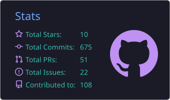
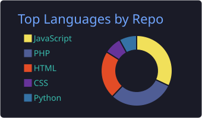
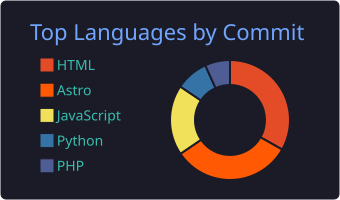
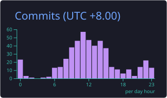
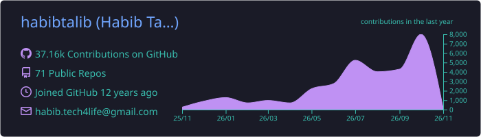

  

  
  
  
  
  

---

### What I'm building

- **iLuvQuran** — CTO. Architecture and infrastructure for the LMS and platform estate. I set the direction, and I'm still in the codebase.
- **Synctexts Solution** — Production systems for clients across Malaysia: enterprise platforms, government systems, e-invoicing, payments.
- **AI agent tooling** — My delivery pipeline runs itself: plan locally, execute autonomously overnight, review in the morning. That's what the graph below is.

---

### 📊 By the numbers

  
  

  
  

  

  

  <picture>
    <source media="(prefers-color-scheme: dark)" srcset="https://raw.githubusercontent.com/habibtalib/habibtalib/output/github-snake-dark.svg" />
    <source media="(prefers-color-scheme: light)" srcset="https://raw.githubusercontent.com/habibtalib/habibtalib/output/github-snake.svg" />
    
  </picture>

---

### 🚀 Selected work

| Project | What it is |
|---|---|
| **[claude-jira-multi](https://github.com/habibtalib/claude-jira-multi)** | One token-based MCP server for every Atlassian site you own. Auto-resolves the right Jira account from your working directory — no OAuth re-auth, ever. Installs as a Claude Code plugin. |
| **[filament-logger-v5](https://github.com/habibtalib/filament-logger-v5)** | Activity and audit logging for Filament v4/v5 — model changes plus login/logout/failed-auth. Rebuilt because upstream stopped at v3. |
| **[kursus-laravel-4hari](https://github.com/habibtalib/kursus-laravel-4hari)** | A full 4-day Laravel course — notes, hands-on labs, references. In Bahasa Melayu, because good material shouldn't only exist in English. |

---

### 🛠️ Stack

  

---

  Building something that needs to actually work in production? <a href="https://synctexts.com"><b>Let's talk.</b></a>

